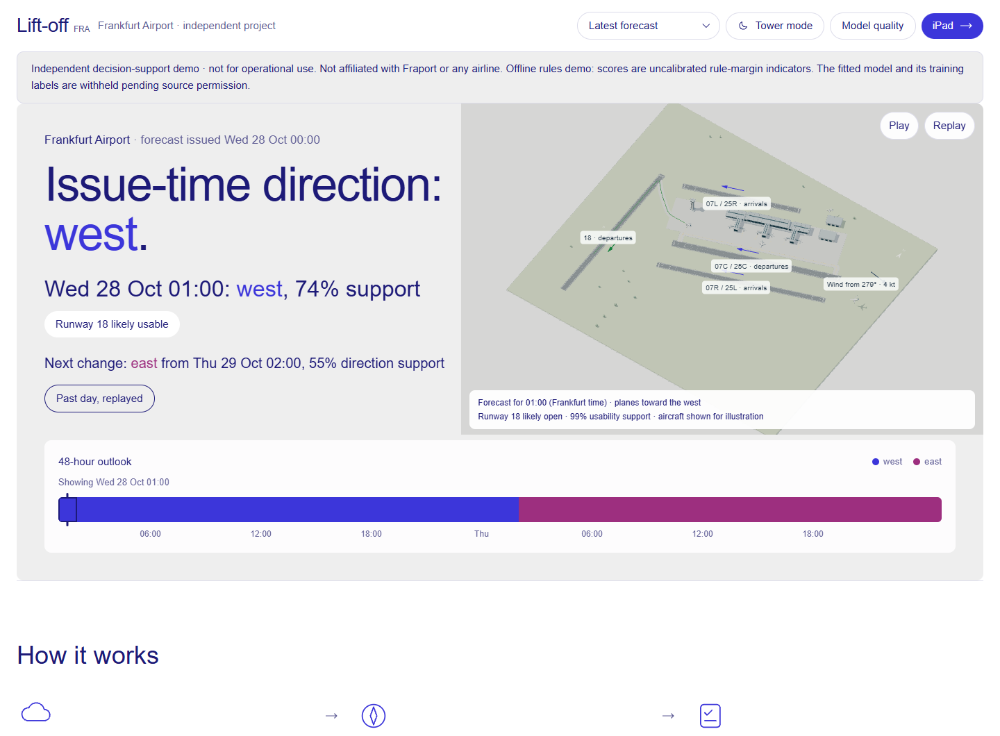

# Lift-off · Frankfurt Runway Outlook

A 48-hour hourly outlook for Frankfurt Airport runway direction, runway-18 weather usability and the next likely direction change.



For airport and airline operations staff exploring how advance weather information could support preparation and handovers, and engineers evaluating runway-direction forecasting. Select an hour, inspect its wind and uncertainty, and compare direction changes with runway-18 restrictions.

[Timeline, tablet, model-quality and 3D screenshots](docs/images/README.md)

**Deutsch:** Ein stündlicher 48-Stunden-Ausblick auf die Betriebsrichtung am Flughafen Frankfurt und die wetterbedingte Nutzbarkeit der Startbahn 18. Die Zeitleiste und Tabletansicht helfen beim Prüfen möglicher Änderungen. Die öffentliche Ausgabe zeigt eine offline berechnete Regelprognose; trainiertes Modell und Betriebsrichtungsdaten bleiben bis zur Klärung der Datenrechte ausgeschlossen. Unabhängige Demonstration, nicht für den operativen Einsatz.

**Independent decision-support demo, not for operational use. Not affiliated with Fraport or any airline.** The historical fitted model and the direction records are not in this repository, because we have no permission to redistribute them. The public example runs on licensed weather and the rule baseline. Its scores are uncalibrated and separate from the measured model results below.

## Quickstart

Requires Node.js 22.18+ (24 tested).

```sh
git clone https://github.com/werister/aiw-codex-hack.git
cd aiw-codex-hack
cd web
npm ci
npm run dev
```

Open **http://127.0.0.1:3000**. No Python setup, account or API key is needed for the saved dashboard. Select hours on the overview, expand **Hourly forecast** for the full timeline, or open `/widget` for the tablet view. `/quality` contains historical model evaluation and `/model-card/` explains its limits. The bundled data are a fixed historical example, not a live airport feed.

For a newly computed offline forecast, use Python 3.12 or 3.13 (3.12 tested locally), from the repository root:

```sh
python -m venv .venv
```

Activate it with `.venv\Scripts\Activate.ps1` in PowerShell, or `source .venv/bin/activate` on macOS/Linux, then:

```sh
python -m pip install -r ml/requirements.txt
python -m ml.forecast --demo
python -m ml.forecast --demo --json --out web/public/forecasts/latest.json
```

This computes 48 hours from the committed IEM METAR and archived Open-Meteo weather for 28 October 2026. It uses no network, recorded direction labels or fitted weights. [Usage and research commands](docs/USAGE.md) cover date-based forecasts, downloads and local inputs.

## How the model works

The historical model learned how runway direction relates to airport wind, archived weather-model forecasts and the current direction. Gradient-boosted trees combine runway tailwinds, forecast disagreement, pressure differences and rule-state features. At short leads, a blend with persistence helps when the current direction is informative; blend weights are selected using earlier validation data.

Direction labels came from a public operating-direction proxy. Runway-18 targets were inferred from wind limits, not observed operational closures. The public offline example runs the rule state machine directly because source rights for the fitted model remain unresolved. [Operating rules](docs/OPERATING_RULES.md) and [model card](MODEL_CARD.md) explain the distinction.

## Measured model results

Historical `walk-forward-v6`, monthly expanding walk-forward evaluation, November 2025–October 2026. Each test month was excluded from its fit, **but test results informed development; this is not an untouched final test**.


| Lead | Fitted model | Rule baseline | Persistence |
|---|---:|---:|---:|
| 1 h | 95.7% | 93.1% | 95.9% |
| 6 h | 92.7% | 88.1% | 88.8% |
| 24 h | 91.8% | 87.7% | 75.1% |

The 1-hour model does not beat persistence in accuracy. The chart and [evaluation report](docs/EVALUATION.md) include 95% intervals, counts, Brier scores and exact reproduction commands. `python -m ml.evaluate` reads the retained historical aggregate; it does not recompute predictions. The cleanup audit also attempted replay of the original monthly fits before restricted files were withheld; its result and any discrepancies are recorded in the evaluation report. Independent replay from the public package requires permission-cleared labels and fitted artifacts.

Change-event scoring is separate from hourly accuracy. The historical report matched 115 of 193 unique direction changes within ±3 hours, with 138 false-alarm clusters. Runway-18 rare-event performance remains weak: 0 of 12 positive 24-hour issue windows detected, with only 307 complete windows and 1,125 excluded. These are wind-inferred closure labels, not verified runway closures. **None of these fitted-model metrics describe the rules demo.**

## Limits

- Public direction records are a proxy, not a certified operations log. Stable-hour scoring excludes change hours; a suspect source interval remains in the primary results and has separate sensitivity analysis.
- Archived forecast availability is approximate. A six-hour publication buffer is an assumption, not verified publication metadata.
- Certainty is a probability-margin score, not calibrated joint correctness. Next-change support is an hourly direction probability; its timing window is heuristic.
- No certified traffic, capacity, aircraft eligibility, clearance or financial-benefit prediction is included. The 3D traffic is illustrative.

See [data rights and full inventory](docs/DATA_SOURCES.md), [evaluation](docs/EVALUATION.md) and [model card](MODEL_CARD.md).

## Data sources

Normalized weather comes from [Iowa Environmental Mesonet](https://mesonet.agron.iastate.edu/disclaimer.php) (public domain), [Open-Meteo](https://open-meteo.com/en/licence) and [DWD CDC](https://opendata.dwd.de/climate_environment/CDC/Nutzungsbedingungen_German.pdf) (CC BY 4.0), plus NOAA/NWS snapshots. Units, timestamps and missing values are normalized; original provider attribution remains required. Open-Meteo's data licence and free-API noncommercial service terms are separate; business use needs suitable service access.

Restricted direction tables, fitted weights, third-party research PDFs and copied source archives are excluded. [DATA_SOURCES.md](docs/DATA_SOURCES.md) lists each original dataset, size, licence and removal decision. The source parser remains available for research with lawfully supplied inputs.

## Project layout

```text
ml/                    Weather, rules, features, forecast CLI, training and tests
web/                   Next.js dashboard, tablet view and public weather snapshots
data/                  Licensed normalized weather and retrieval metadata
docs/                  Usage, evaluation, source rights and real screenshots
tools/blender/         Optional procedural source for the airport illustration
```

The Python/web interface is `web/src/lib/forecast-types.ts`. Rules are versioned in `ml/rules.json`. The optional 3D assets are original unbranded geometry; [rebuilding instructions](docs/3D.md) are separate from the dashboard quickstart.

## Contributing and licence

[Contributing](CONTRIBUTING.md) describes checks and evidence requirements. Proposed code licence: [MIT](LICENSE), **pending approval by all four original authors**. Data retain their own terms; the code licence does not license third-party datasets.

Created by **Kai Detmers, Jayden Bruck, Hugo Hader and Luca Schultz**.
