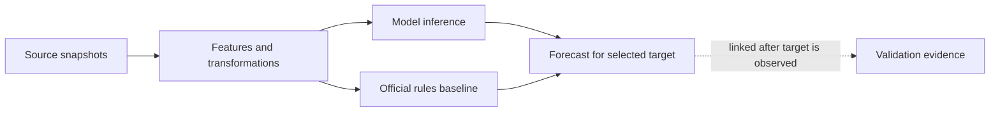

# Forecast evidence trail: local dashboard pattern

**Research date:** 2026-10-30

**Scope:** A small, clickable evidence view inside the DFS-inspired local forecast dashboard. Framework products are reference material only; this does not propose adding LangChain, LangGraph, MLflow, or a hosted tracing service.

## Recommendation

Keep the current ops timeline as the starting point. Selecting an hourly forecast opens a compact flow for that target hour. Nodes are clickable; selecting one shows its captured inputs, outputs, source references, timestamps, and version identifiers. Use a visible distinction between values the pipeline actually captured and details that are unavailable. The graph explains the data and computation path, not private model reasoning.



For the 48-hour forecast, show one selectable target node per hour, or open a selected hour in this same detail flow. Validation is visually separate because its target evidence becomes known only after forecast issuance; it must not feed the prediction path. A row-level unavailable badge is better than an empty graph edge or an inferred value.

## What existed in the inspected checkout

Snapshot: `hugo/forecast-ui-spec` at `74a56044aa1317fcb31eed105fb9f0be02931c30`. The absence statements in this section describe that historical checkout only. Later remote main contains an implemented pipeline, UI and evaluation artifacts; this research note is not a current implementation-status report.

The repository index was built before code discovery because this checkout was not indexed. Graph lookup identified the TypeScript response contract and UI entry point; source snippets confirmed the current definitions. The producer implementation is absent from this checkout: `ml/` contains a README, requirements and `rules.json`, while `web/src/app/page.tsx` is still a placeholder.

The current `ForecastResponse` contract declares `issued_at`, `issued_local`, `mode`, `current_od`, `nwp`, `model_version`, `rules_version`, and `hours`. Each `HourForecast` declares valid time, local time, lead, forecast wind/gust, signed tailwind components, rules baseline outputs, model probabilities, OD, runway-18 probability and certainty. It does **not** declare exact source-run IDs or snapshot hashes, raw source records, the exact post-transformation model feature vector, transformation version, code revision, model artifact hash/training run, or per-field missing/fallback status. The contracts are declarations, not evidence that a producer currently emits these values.

The ML README names Iowa Environmental Mesonet EDDF METAR observations and Open-Meteo Previous Runs for historical weather inputs, and specifies issue-time constraints for hindcasts. `ml/rules.json` currently has rules version `fraalliance-brief-2026-10-30`, formula, runway headings, thresholds and notes. These are useful provenance sources, but current docs do not show an inference-time evidence record or persisted trace.

## Dashboard elements and producer evidence contract

Every visible value below must map to a producer-emitted and durably stored field (or to an immutable artifact reference that can retrieve the exact value). A hash alone proves identity but cannot recreate missing content. For audit/replay, persist either the actual source values used or a durable immutable snapshot pointer plus its content hash. Do not use a mutable “latest” endpoint as the sole provenance.

| Clickable element | Details shown on selection | Producer must emit/store |
|---|---|---|
| **Forecast run** (root) | Issue time in UTC and Europe/Berlin; live/hindcast; selected target and lead; run status | `forecast_id`, `trace_id`, `issued_at`, `mode`, `created_at`, `completed_at`, code revision (`git_commit`, dirty-state flag if known), feature/output schema versions, runtime/package versions if captured, overall status/error. Stable join key: `forecast_id`. |
| **Source snapshot(s)** | Source name, product/endpoint, retrieval time, source run/initialization time, valid time, exact values used, coverage/missingness | For each source: `source_id`, provider/product, request parameters or selection key (e.g. Open-Meteo model product and previous-run column), `retrieved_at`, `source_issued_at` where available, `valid_at`, immutable `snapshot_uri` or stored record, `content_sha256`/dataset digest, units, and field/value map. If a value was unavailable, store its status and reason. |
| **Features / transformations** | Raw wind direction/speed/gust and derived signed runway tailwinds; values passed to the estimator; formula/version | `feature_schema_version`; ordered named `raw_features`; ordered named **post-transform `model_features` exactly as passed to `predict`/`predict_proba`**; units and null markers; transformation/preprocessor version or code revision; explicit transform outputs. Include the source ID/field for each feature or a stable mapping from feature name to source references. Persisting only the final probability cannot reconstruct this row. |
| **Model inference** | Artifact identity and prediction outputs, with a clear distinction between model prediction and rules baseline | `model_artifact_id`/URI, model version, artifact SHA-256, linked training run ID if known, estimator/config identity; `p_od25`, `p_18_usable`, model-selected OD and per-output status. Preserve model output values at full producer precision; round only for display. Record inference time and any exception/fallback. |
| **Official rules baseline** | Rules version/hash, relevant input values and baseline outputs | `rules_version`, exact rules content hash, implementation/code revision, rule input values/state (including the issue-time OD and any hysteresis state needed), `rule_od`, `rule_18_usable`, and output status. This is a parallel baseline computation; do not label it as the model output. |
| **Forecast target** (one node per hour) | UTC valid time, local time with numeric UTC offset, lead; model outputs, rule outputs, selected OD, runway-18 probability/status and certainty definition | `hour_id`, `forecast_id`, `valid_at` UTC, local timestamp/offset, `lead_h`, links to source/features/model/rules spans, and the exact serialized output row emitted to the UI. Stable target join key: `forecast_id + valid_at_utc + lead_h`; never join by local clock text alone (DST repeats an hour). |
| **Validation** (separate branch or linked record) | Reference target and provenance by outcome; metric name/value/sample and evaluation window; explicit coverage/exclusions | `evaluation_id`, linked `forecast_id` and `hour_id`, `evaluated_at`, reference source and provenance per target (OD and runway-18 separately), label/rules version, reference value/status, metric definition/value/sample count, test period/fold and exclusions. Keep validation/evaluation artifacts separate from inference inputs and outputs. |

### Minimum typed record (proposed, not implemented)

These TypeScript shapes define a payload the Python producer can serialize as JSON for the local UI. The graph can be rendered directly from these records and their IDs; no tracing SDK or hosted service is needed. One forecast invocation has a root `forecast_id`; every target hour has a stable `hour_id` derived from the forecast ID, UTC validity time and lead. Evidence records have explicit IDs and parent IDs so the UI can render and select graph nodes without reconstructing edges from labels. Names below describe proposed fields, not existing producer output.

```ts
type EvidenceStatus = "ok" | "partial" | "unavailable" | "error";
type PredictionSource = "trained_model" | "rules_fallback";

interface EvidenceNode {
  evidence_id: string; // stable within this forecast; unique node key
  forecast_id: string;
  hour_id: string;
  parent_ids: string[];
  started_at: string; // UTC ISO timestamp
  completed_at: string;
  status: EvidenceStatus;
  unavailable_reason?: string;
}

interface SourceSnapshot extends EvidenceNode {
  kind: "source_snapshot";
  provider: string;
  product: string;
  request_key: Record<string, string | number | boolean>;
  retrieved_at: string;
  source_issued_at?: string;
  valid_at: string;
  snapshot_uri?: string; // immutable stored record or file; required if values aren't inline
  content_sha256: string;
  units: Record<string, string>;
  values: Record<string, number | string | boolean | null>;
  missing_fields?: Record<string, string>; // field -> reason
}

interface FeatureComputation extends EvidenceNode {
  kind: "feature_computation";
  feature_schema_version: string;
  transform_version: string;
  source_fields: Record<string, { evidence_id: string; field: string }>;
  raw_features: Record<string, number | string | null>;
  derived_features: Record<string, number | string | null>;
  model_feature_order: string[];
  model_features: Array<number | null>; // exact ordered vector passed to the estimator
}

interface ModelInference extends EvidenceNode {
  kind: "model_inference";
  prediction_source: PredictionSource;
  model_artifact_id?: string;
  model_version?: string;
  model_sha256?: string;
  training_run_id?: string;
  prediction_status: EvidenceStatus;
  fallback_reason?: string;
  p_od25: number | null;
  p_18_usable: number | null;
  model_od: "25" | "07" | null;
}

interface RulesEvaluation extends EvidenceNode {
  kind: "rules_evaluation";
  rules_version: string;
  rules_sha256: string;
  rules_code_revision?: string;
  rule_state: Record<string, number | string | boolean | null>;
  rule_inputs: Record<string, number | string | boolean | null>;
  rule_od: "25" | "07" | null;
  rule_18_usable: boolean | null;
}

interface ForecastHourOutput {
  hour_id: string; // `${forecast_id}:${valid_at_utc}:${lead_h}`
  forecast_id: string;
  valid_at: string; // UTC ISO; canonical target key
  local_at: string; // ISO with explicit Europe/Berlin offset
  lead_h: number;
  evidence_ids: string[]; // source, feature, inference, rules node IDs
  od: "25" | "07" | null;
  prediction_source: PredictionSource;
  p_od25: number | null;
  p_18_usable: number | null;
  certainty: number | null;
  certainty_definition: string;
  rule_od: "25" | "07" | null;
  rule_18_usable: boolean | null;
  field_status: Record<string, EvidenceStatus>;
  unavailable_reasons?: Record<string, string>;
}

interface ForecastEvidence {
  schema_version: string;
  forecast_id: string;
  issued_at: string;
  mode: "live" | "hindcast";
  code_revision: { git_commit: string | null; dirty: boolean | null };
  sources_and_computations: Array<SourceSnapshot | FeatureComputation | ModelInference | RulesEvaluation>;
  hours: ForecastHourOutput[]; // one record for each target hour 1..48
}

interface ValidationRecord {
  evaluation_id: string;
  forecast_id: string;
  hour_id: string;
  evaluated_at: string;
  status: EvidenceStatus;
  reference: {
    target: "od" | "runway_18_usable";
    provenance: "recorded" | "inferred" | "published" | "unknown";
    source_id: string | null;
    value: "25" | "07" | boolean | null;
    unavailable_reason?: string;
  };
  metric?: { name: string; value: number; sample_count: number; definition: string };
  coverage?: { start: string; end: string; exclusions: string[] };
}
```

The per-hour payload is the exact forecast output plus evidence-node references. The separate `ValidationRecord` is linked later by `forecast_id`/`hour_id`; it does not mutate the issue-time record. Implementation should define whether the data records are embedded in each published day file or persisted as an adjacent evidence sidecar, but the UI contract stays addressable by these IDs either way.

### Missing and fallback semantics

- Represent missing values explicitly with `status: unavailable` and a short `reason`; preserve `null` only where null is the contract’s defined value (for example, calm/variable wind direction). Never silently substitute another date, latest source run, observed value, or forecast row.
- Mark each partially available source/feature/target separately. A source retrieval failure must remain distinguishable from a successfully retrieved null measurement.
- A fallback must identify `prediction_source: rules_fallback` (or a similarly explicit enum), reason, rules version and actual fallback output. The UI labels it **Rules fallback** and must not imply the probability came from the trained model. If a model probability is unavailable, store null plus unavailable status; do not manufacture a numeric probability to satisfy a display shape. This exposes a contract decision: current `HourForecast` probabilities are non-null numbers, so producer and UI owners need to agree a backward-compatible status/nullable representation before claiming fallback probabilities are honest.
- For validation, record OD and runway-18 reference provenance independently. A recorded OD does not establish a recorded runway-18 label. No matching target means unavailable, not a synthesized reference.
- Keep the producer’s certainty definition attached to the score. The existing UI spec defines it as a margin score, not calibrated probability of joint correctness.

## Mandatory MVP capture vs optional explanation

**Mandatory for a faithful evidence view:** stable run/hour IDs; issue and valid times plus lead; mode; captured source identity/time and exact values (or immutable retrievable snapshot); raw and exact post-transform model feature vectors in estimator order; transform/schema version and important derived values; model artifact identity/version/hash and output probabilities; rules version/hash, relevant state/inputs and baseline results; exact emitted per-hour row; code revision where available; explicit missing/error/fallback statuses; independent target/reference provenance for validation.

**Training and evaluation artifacts (linked, not copied into every inference row):** immutable training/evaluation dataset identities/digests and source manifests; label source/provenance and label version; train/test dates and folds; code revision and dependency lock; fitted model artifact and hyperparameters; evaluation metric definitions/results/sample counts/calibration data. At inference, capture the model artifact ID/hash and training-run link if known. Training metrics alone do not establish what a specific inference consumed.

**Optional explanation:** feature contribution/attribution values only if a named, supported method is actually run against the same captured model input and preprocessing context. Store the method/version and output separately as an explanation artifact. A probability score, a feature list, or a hand-written narrative cannot reconstruct faithful contributions. Do not train the model to narrate its reasoning, and do not present a post-hoc attribution as the model’s hidden reasoning or a causal explanation.

## Concrete dashboard demo story

1. Open the 48-hour timeline and select one target row (for example, lead `+6 h`; use the actual loaded forecast’s time rather than hard-coding a demonstration result).
2. The selected-hour panel shows `valid_at` UTC and Europe/Berlin time/offset, lead, OD, P(OD 25), P(runway 18 usable), and the producer-defined certainty label.
3. Click **Sources**: inspect the exact weather product/run, retrieval and valid times, relevant raw wind values and snapshot reference. Show a visible unavailable state if the chosen run or value was not captured.
4. Click **Features**: inspect signed tailwind components, formula/version and the exact ordered feature vector that entered the estimator.
5. Click **Model** and **Rules** side by side: show model artifact/version/hash and probabilities separately from rules version/hash, inputs/state and `rule_od`/`rule_18_usable`. Display these captured field/value facts directly; do not generate a narrative rationale or claim the model has explained its decision.
6. Open **Validation** as a separate branch. For a hindcast with established references, show each target’s provenance and evaluation coverage; for a live forecast, label validation “not available yet.” Never pass later observations into the forecast-side nodes.

## Supporting documentation patterns

These primary docs support the interface pattern, not a framework adoption. LangSmith models execution as nested runs with inputs/outputs and metadata, and documents manual instrumentation for tracing arbitrary functions. This is a useful reference for node detail and run metadata. [LangSmith observability concepts](https://docs.langchain.com/langsmith/observability-concepts), [LangSmith manual instrumentation](https://docs.langchain.com/langsmith/annotate-code), [LangSmith metadata and tags](https://docs.langchain.com/langsmith/add-metadata-tags).

MLflow documents run metadata/artifacts, dataset source/digest/schema/profile, model version lineage, and trace UIs that show span trees and per-span inputs/outputs. This supports treating identity and stored payload as separate concerns: digests identify exact data, while a trace viewer renders captured execution evidence. [MLflow Tracking](https://mlflow.org/docs/latest/ml/tracking/), [MLflow dataset tracking](https://mlflow.org/docs/latest/dataset/), [MLflow Model Registry](https://mlflow.org/docs/latest/model-registry/), [MLflow trace concepts](https://mlflow.org/docs/latest/genai/concepts/trace), [MLflow trace UI](https://mlflow.org/docs/latest/genai/tracing/observe-with-traces/ui).

Accessed 2026-10-30. Documentation is continuously updated; links were checked on the access date. A LangChain-profile query was not performed because no nlmx/profile-query tool is exposed in this session. The referenced notebook identifier had no original URLs supplied, so its videos were not treated as research evidence.

## Quick challenges for the implementation review

- Can a reviewer recover the exact weather values and model-input vector for one `hour_id` after source APIs change?
- Does every displayed value have an emitting producer field and a stable `forecast_id`/`hour_id` join path, including DST repeated local hours?
- Can rules hysteresis or issue-time state change `rule_od`, and if so is that state captured?
- Can the UI distinguish absent, null/calm, retrieval-failed, partial, model-error and rules-fallback cases without making a fake probability?
- Are trained-model output, rules baseline, and selected forecast output distinct records/fields?
- Are references and metrics produced only after the target is known, separately for OD and runway-18 usability, with provenance and exclusions?
- If attribution is shown, is it computed by a named method on the exact model input and described as an explanation estimate rather than the model’s reasoning?
