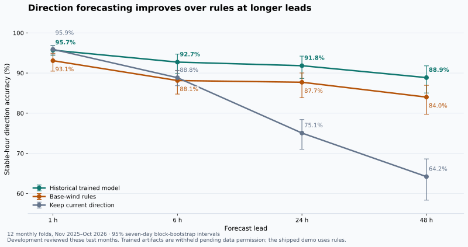

# Measured evaluation

These are historical measurements of `walk-forward-v6`, the trained classifier.
They are **not scores for the shipped `rules-demo` forecast**. Direction labels
and fitted artifacts are withheld pending source permission; the offline demo
uses licensed weather snapshots and computes a clearly labelled rule forecast.

The original saved monthly fits were replayed without training during the
publication audit. The exact aggregate output is
[evaluation-replay.json](evaluation-replay.json); it contains scores and artifact
hashes, not individual source labels or fitted models.

The replay reproduces all accuracy estimates, their accuracy intervals and
event counts. Floating-point probability scores differ slightly under the
tested runtime: the 1-hour model Brier score is 0.0341372052 rather than the
original 0.0341371550. The largest numerical difference anywhere in the checked
summary is 0.0000019072, in a p-value. Rounded conclusions are unchanged. The
original published evaluation remains available alongside the replay output;
the chart and tables here use the replay.



## What was compared

The comparison uses expanding monthly folds from November 2025 through October
2026. Each month uses a model fitted only on earlier labels; outcomes crossing
a training boundary are purged. Issues are six-hourly on the Europe/Berlin
clock. All methods in a row use the same eligible, recorded stable-hour targets.
Transition hours are excluded from this hourly accuracy table.

- **Trained model:** gradient-boosted classifiers with chronological validation
  weights blending the direction prediction with the state known at issue.
- **Base-wind rules:** the documented wind-limit state machine applied to the
  archived best-match wind forecast, retaining the known state/tailwind timer.
- **Keep current:** retain the recorded direction known at issue time.

## Direction accuracy

Percentages with 95% **seven-day block-bootstrap** intervals in brackets.
The resampling unit is a contiguous block of issue days, preserving paired
methods. Missing calendar gaps are never bridged.

| Lead | Scored hours | Trained model | Base-wind rules | Keep current |
|---|---:|---:|---:|---:|
| 1 h | 1,416 | 95.7 [94.4–96.8] | 93.1 [90.5–94.9] | 95.9 [94.7–96.8] |
| 6 h | 1,416 | 92.7 [89.9–94.7] | 88.1 [84.8–90.6] | 88.8 [86.8–90.7] |
| 24 h | 1,383 | 91.8 [88.7–94.2] | 87.7 [83.9–90.0] | 75.1 [71.0–78.4] |
| 48 h | 1,338 | 88.9 [85.0–91.8] | 84.0 [79.7–86.9] | 64.2 [58.3–68.6] |

The model's paired accuracy advantage over base-wind rules is +4.6 percentage
points at 6 h [2.7–6.5], +4.1 at 24 h [3.1–6.3], and +4.9 at 48 h [3.5–7.2].
It establishes no accuracy advantage over keep-current at 1 h: the paired
interval is −1.1 to +0.6 percentage points.

There is also a stronger rule comparator using corrected multimodel wind.
Its 1/6/24/48 h accuracies are 93.3/88.8/89.2/85.8% on the same cohorts.
At 24 h the model's advantage over that comparator is +2.7 points [1.4–4.8],
smaller than its advantage over the base-wind rule. Full Brier scores and
paired comparisons are retained in the aggregate JSON.

The earlier baseline documentation quoted an obsolete model revision and called
these months unseen. The values here use the replayed v6 result. Development
and repeated review used these test months: **this is not an untouched final
validation set**, despite each individual fold's chronological split.

## Direction changes and runway 18

Hourly direction accuracy is not event-detection recall. The unique-transition
report matches directional first-change warnings one to one within ±3 hours,
with the warning issued before the event. It matches **115 of 193** actual
transitions (59.6% recall), with **138 false-warning clusters** and **45.5%
deduplicated precision**. The matched warning lead has a 12-hour median; the
matching minimizes timing error, so this is not earliest useful warning time.

The separate overlapping-window score has 750 windows with a real next change:
27.2% are predicted within ±1 hour and 52.5% within ±3 hours. The 14.7%
false-alarm rate divides warned no-change windows by 593 no-change windows;
it is not the proportion of all warnings that are false. There are 89 excluded
incomplete windows.

Runway-18 labels describe **METAR-inferred weather usability**, not observed
operational closure. Unknown/variable directions stay unlabelled. A positive
window contains at least one inferred closed hour; windows overlap.

| Horizon | Complete windows | Positive windows | Model hits | Model false alarms | Excluded windows |
|---|---:|---:|---:|---:|---:|
| 1 h | 1,073 | 5 | 0 | 0 | 359 |
| 6 h | 760 | 10 | 0 | 0 | 672 |
| 24 h | 307 | 12 | 0 | 0 | 1,125 |

These results do not establish runway-18 closure forecasting skill. A high
hourly usable-state accuracy would be dominated by the common open state.
DFLD runway-18 non-use is not equivalent to a weather closure and was rejected
as the closure target.

## Limits retained from independent review

- Exact historical forecast publication times are not available. Six-hour
  availability buffers and previous-day offsets are proxies, not verified
  publication timestamps. DFLD reporting delay and summer-clock alignment
  remain unverified; the direction reference is a public operational proxy.
- Full-run rule-disagreement flags can depend on weather after an earlier
  training boundary. They are used only for separately labelled sensitivity,
  not primary label removal or model inputs. The retained causality tests
  demonstrate this counterexample; passing them does not fix the mechanism.
- Forecast windows overlap, and weather persists across days. One-, three- and
  seven-day intervals are sensitivity views of dependence, not proof of
  operational generalization. Nominal McNemar p-values ignore within-day
  dependence; daily-loss tests use limited autocorrelation correction. Multiple
  comparisons are not adjusted.
- The probability-margin certainty score and next-change time window are
  uncalibrated. Input evidence records values and selected artifact identity;
  it does not provide per-feature causal attribution or a complete immutable
  inference-code snapshot.
- Historical supplementary-model tests required removed research adapters and
  datasets; they were not performance evidence for the served model. Useful
  temporal and fitted-model contract checks were moved into `ml/tests/`.
  Fitted-artifact checks are explicitly skipped when withheld artifacts are absent.

## Commands and reproducibility

From the repository root, the publication audit ran:

```sh
python -m ml.evaluate --replay --out data/raw/metrics-replay.json
python -m pytest ml/tests -q
python -m ml.forecast --demo --json --out web/public/forecasts/sample.json
python -m pip install -r ml/requirements-docs.txt
python -m ml.plot_evaluation --input docs/evaluation-replay.json
```

`--replay` rebuilds issue-time features, applies each original saved monthly fit
to its original test month and recomputes intervals and event scores. It never
fits a model. The audit ran with one numerical-computing thread and recorded
artifact hashes in the output. The replay requires the withheld labels and fits;
a fresh public clone cannot recompute the historical results without lawful
source access and a compatible local model run. Do not claim otherwise.

A fresh clone can inspect the historical report and regenerate its chart:

```sh
python -m ml.evaluate
python -m pip install -r ml/requirements-docs.txt
python -m ml.plot_evaluation
```

The first command explicitly reports **published historical evaluation; not
recomputed predictions**. To reproduce training after source permission and
appropriate input acquisition, see [pipeline commands](../ml/README.md) and
[data sources and rights](DATA_SOURCES.md). Numerical thresholds and the rule
implementation are preserved independently of the withheld labels.
