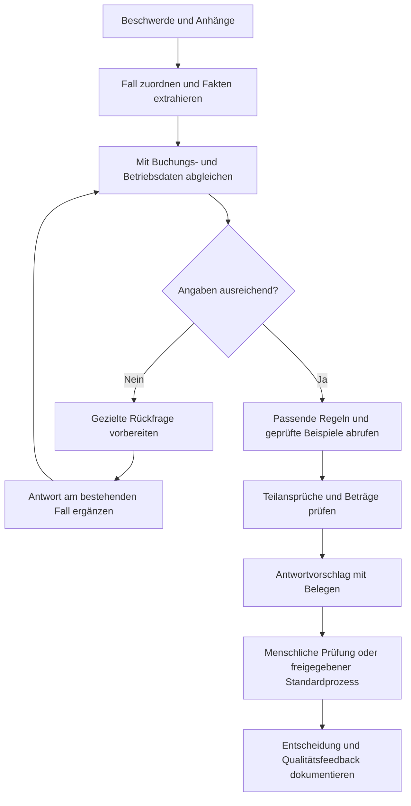

# Condor: Beschwerdebearbeitung mit KI

Anforderungen aus dem Vortrag, Webrecherche und Lösungsvorschlag für den AI Week Codex Hackathon. Stand: **30. Oktober 2026**.

**Empfehlung:** Einen Assistenten bauen, der Beschwerden strukturiert, fehlende Angaben gezielt nachfordert und eine begründete Bearbeitung vorbereitet. Geprüfte Altfälle liefern Beispiele und Qualitätsmaßstäbe; versionierte Rechtsregeln und interne Richtlinien bestimmen die zulässigen Entscheidungen. Nach einem begleiteten Pilot können eng definierte Standardfälle schrittweise automatisiert werden.

Die Angaben zu Condors internen Abläufen und Mengen stammen ausschließlich aus dem bereitgestellten englischen Vortragstranskript. Die folgenden Abschnitte kennzeichnen recherchierte Fakten und eigene Vorschläge. Interne Falldaten, Qualitätsprüfungen, Richtlinien und Systemzugänge liegen noch nicht vor.

## 1. Was Condor gefragt hat

Condor sucht eine skalierbare KI-Lösung für Customer Care, die aus Beschwerden und nachweislich guten Bearbeitungen lernt. Sie soll zunächst einfache Fälle mit menschlicher Kontrolle bearbeiten und später auch komplexere Fälle übernehmen. Zwei Ansätze wurden ausdrücklich genannt: Lernen aus historischen Ein- und Ausgaben sowie die Anwendung einer Wissensbasis mit Gesetzen und internen Regeln.

### Ausgangslage laut Vortrag

| Thema | Aussage aus dem Vortrag |
| --- | --- |
| Zuständigkeit | Customer Care begleitet Kundenanliegen von der Buchung bis nach der Reise. |
| Volumen | Im genannten Oktober ungefähr 15.000 Beschwerden; insgesamt ungefähr 100.000–150.000 pro Jahr. |
| Bearbeitung | Externe Servicecenter bearbeiten die Fälle heute vollständig manuell. |
| Qualität | Hohe Kosten und Unterschiede in der Bearbeitungsqualität; zusätzlich manuelle Qualitätskontrollen. |
| Datenbasis | Tausende abgeschlossene Fälle sowie eine nicht bezifferte Zahl qualitätsgeprüfter Ergebnisse. |
| Wissensbasis | Dokumentierte interne Regeln und öffentliches Recht, beispielsweise EU-Fluggastrechte und thailändische Vorschriften. |
| Informationslücken | Häufig fehlen Buchungsreferenz, Schadenfoto oder weitere Angaben. Wiederholte Rückfragen sind standardisiert und zeitaufwendig. |
| Saisonalität | Viele Beschwerden nach der Sommersaison, deutlich weniger im Januar; aktuell lange Bearbeitungszeiten. |
| Fallbreite | Beschädigte Gepäckteile bis zu Ketten aus Annullierung, Unwetter, Umbuchung und Herabstufung der Reiseklasse. |

Die Jahresmenge ist eine eigenständige Schätzung des Vortragenden. 15.000 × 12 wären 180.000; dieser Oktoberwert darf wegen der beschriebenen Saisonalität nicht als Jahresdurchschnitt verwendet werden. Die ebenfalls genannten Frankfurter Verkehrszahlen werden für die Lösung und Wirtschaftlichkeitsrechnung nicht benötigt und wurden nicht separat verifiziert.

### Daraus abgeleitete Anforderungen

| ID | Anforderung | Woran man ihre Erfüllung erkennt |
| --- | --- | --- |
| A1 | Beschwerden und Anhänge verstehen | Anliegen, Sprache, Reise und vorhandene Belege werden strukturiert erfasst. |
| A2 | Fehlende Informationen erkennen | Eine passende Rückfrage benennt nur die tatsächlich noch benötigten Angaben. |
| A3 | Geprüfte Bearbeitungen nutzen | Relevante freigegebene Vergleichsfälle unterstützen einen neuen Fall. |
| A4 | Recht und Richtlinien anwenden | Jeder Entscheidungsvorschlag nennt die passende Quelle und deren Version. |
| A5 | Mit einfachen Fällen beginnen | Eine klar begrenzte Fallgruppe wird zunächst vollständig durch Menschen kontrolliert. |
| A6 | Komplexität beherrschen | Mehrere Teilansprüche werden getrennt betrachtet und bei Unsicherheit weitergegeben. |
| A7 | Aus Korrekturen besser werden | Bewertete Korrekturen verbessern spätere Systemversionen nach messbarer Prüfung. |
| A8 | Gleichbleibende Qualität erreichen | Fachlich richtige und vollständige Ergebnisse werden anhand eines unabhängigen Testbestands geprüft. |
| A9 | Zeit und Rückfragen reduzieren | Aktive Bearbeitungszeit, Wartezeit und Zahl der Kontaktwechsel sinken gegenüber dem Ausgangswert. |
| A10 | Saisonale Spitzen abfangen | Eine Warteschlange verarbeitet Lastspitzen kontrolliert und zeigt Rückstände an. |

Der angebotene Business-Class-Upgrade-Anreiz für das Gewinnerteam ist ein Hackathon-Anreiz, keine Produktanforderung.

## 2. Was die Recherche für die Lösung verändert

### Bestehende Prozesse weiterverwenden

Condor bietet bereits einen Selfservice für verspätetes oder beschädigtes Gepäck an. Dort lassen sich Meldungen anlegen, Suchstände verfolgen und Informationen ergänzen. Für die Schadensabwicklung nennt Condor unter anderem Dolfi 1920 und einen direkten Weg zu Customer Care. Ein zusätzliches KI-Formular sollte deshalb an vorhandene Vorgänge anschließen und doppelte Meldungen vermeiden. Ob dafür APIs verfügbar sind, ist offen. [Condor: Gepäckservice](https://www.condor.com/eu/flight-preparation/baggage-and-animals/delayed-or-damaged-baggage.jsp)

### Assistenz ist empirisch plausibel, der Nutzen muss lokal gemessen werden

Die Studie *Generative AI at Work* untersuchte 5.172 Supportmitarbeitende eines Softwareunternehmens. KI-Unterstützung erhöhte die gelösten Anliegen pro Stunde im Mittel um 15 %, mit deutlichen Unterschieden nach Erfahrung. Verantwortlich blieben Menschen. Die Studie belegt weder eine bestimmte Einsparung bei Condor noch eine sichere autonome Entscheidung über Fluggastansprüche. Sie unterstützt den Einstieg über Agentenassistenz und einen gemessenen Pilot. [Brynjolfsson, Li und Raymond, QJE 2025](https://academic.oup.com/qje/article/140/2/889/7990658)

### Lernen und Regelanwendung ergänzen sich

Retrieval-Augmented Generation, kurz RAG, stellt einem Sprachmodell passend abgerufene Dokumente bereit. Die ursprüngliche Arbeit verbindet Modellwissen mit externem Wissen und zeigt Verbesserungen in untersuchten Wissensaufgaben. Daraus folgt keine Garantie für korrekte Rechtsanwendung. Für Condor ist der praktische Nutzen, passende Regeln und geprüfte Beispiele gezielt bereitzustellen. [Lewis et al., NeurIPS 2020, überarbeitete Fassung 2021](https://arxiv.org/abs/2005.11401)

**Eigene Bewertung der Optionen:**

| Ansatz | Nutzen für Condor | Grenze | Empfehlung |
| --- | --- | --- | --- |
| Nur Training auf bisherigen Antworten | Kann typische Formulierungen und Bearbeitungsmuster lernen | Alte Fehler, damalige Rechtsstände und Kulanzentscheidungen können übernommen werden | Kein geeigneter alleiniger Einstieg |
| RAG mit Wissensbasis | Liefert auffindbare, aktualisierbare Quellen | Ein Modell kann Quellen falsch auswählen oder anwenden | Für die fachliche Grundlage verwenden |
| Feste Regeln und Vorlagen | Berechenbare Beträge und klare Abläufe | Freitext und vielfältige Beschwerden erfordern zusätzliche Verarbeitung | Für klar spezifizierte Entscheidungen verwenden |
| Kombination aus KI, Regeln, Beispielen und Prüfung | Verbindet Sprachverständnis mit überprüfbaren Entscheidungen | Benötigt gute Daten, Pflege und Evaluation | Empfohlener Ansatz |

Für den Ablauf genügt zunächst eine feste Verarbeitungskette. Anthropic unterscheidet solche Workflows von frei gesteuerten Agenten und empfiehlt einfache Lösungen, wenn Aufgaben klar zerlegbar sind. Diese Architekturüberlegung ist von einem bestimmten Modellanbieter unabhängig. [Anthropic: Building effective agents, 19.12.2024](https://www.anthropic.com/research/building-effective-agents)

## 3. Rechtliche Regeln, die das System unterscheiden muss

Die folgenden Befunde begründen die Architektur. Ein produktiver Regelkatalog braucht die fachliche Freigabe durch Condor Legal und Customer Care.

| Bereich | Recherchierter Befund | Konsequenz für die Umsetzung |
| --- | --- | --- |
| EU-Fluggastrechte | Ankunftsverspätung, Entfernung, Anwendungsbereich und Ausnahmen bestimmen den Ausgleich; typische Stufen sind 250, 400 und 600 Euro. | Abflugverspätung allein genügt nicht. Reise und tatsächliche Durchführung müssen verifiziert werden. [Condor: Fluggastrechte](https://www.condor.com/de-de/rechtliche-hinweise/fluggastrechte/) |
| Außergewöhnliche Umstände | Die Airline muss Voraussetzungen einer Befreiung vom Ausgleich belegen. | Das Wort „Hurrikan“ im Kundentext darf keine automatische Ablehnung auslösen. Ursache, Zusammenhang und zumutbare Maßnahmen prüfen. [EU: Fluggastrechte](https://europa.eu/youreurope/citizens/travel/passenger-rights/air/index_en.htm) |
| Betreuung trotz außergewöhnlicher Umstände | Der EuGH bestätigt im Fall McDonagh, dass die Betreuungspflicht bei einer Annullierung auch unter außergewöhnlichen Umständen bestehen kann. | Ausgleichszahlung, Betreuung und weitere Ansprüche als getrennte Prüfpunkte führen. [EuGH, C-12/11, Mitteilung zum Urteil vom 31.01.2013](https://curia.europa.eu/site/upload/docs/application/pdf/2013-01/cp130008en.pdf) |
| Herabstufung | Je nach Strecke kommen 30, 50 oder 75 % des maßgeblichen Ticketpreises in Betracht; bei mehreren Segmenten betrifft dies das herabgestufte Segment. | Gebuchte und geflogene Klasse sowie Preisanteile brauchen eigene Datenfelder. [EU: Downgrading](https://europa.eu/youreurope/citizens/travel/passenger-rights/air/index_en.htm) |
| Gepäckhaftung | Seit 28.12.2024 beträgt die reguläre Haftungsgrenze für Gepäck 1.519 Sonderziehungsrechte. | Kein pauschaler Auszahlungsbetrag und kein fest eingebauter Euro-Wert. Ältere Fälle können andere Grenzwerte haben. [ICAO, 18.10.2024](https://www.icao.int/news/international-air-travel-liability-limits-set-increase-enhancing-customer-compensation-0) |
| Aufgegebenes Gepäck und Handgepäck | Art. 17 des Montrealer Übereinkommens unterscheidet die Haftung: Bei nicht aufgegebenem Gepäck ist insbesondere ein Verschulden des Beförderers oder seiner Leute relevant. | Ein abgebrochenes Rad ist sprachlich einfach, rechtlich aber noch kein eindeutiger Standardfall. Gepäckart und Schadensablauf ermitteln. [Montrealer Übereinkommen, Art. 17, amtlich veröffentlichter Vertragstext](https://www.legislation.gov.uk/uksi/2002/263/schedule/1/made?view=plain) |
| Schriftliche Gepäckanzeige | Art. 31 nennt bei beschädigtem aufgegebenem Gepäck spätestens sieben Tage ab Empfang, bei Verspätung spätestens 21 Tage ab Bereitstellung. | Eingang, Gepäckerhalt und Anzeigen getrennt speichern. Diese Fristen nicht pauschal auf Verlustfälle übertragen. [Montrealer Übereinkommen, Art. 31](https://www.legislation.gov.uk/uksi/2002/263/schedule/1/made?view=plain) |
| Thailand | CAAT nennt für Regulation 101 den 20.05.2025 als Anwendungsbeginn. Der dargestellte Geltungsbereich umfasst internationale Abflüge aus Thailand auch bei ausländischen Airlines; Charter hat eigene Regeln. | Rechtsräume anhand des konkreten Fluges ermitteln. Bei möglicher Überschneidung mit EU-Recht ist eine freigegebene Kollisionsregel erforderlich. [CAAT: Passenger Rights Protection](https://www.caat.or.th/en/aviation/passenger/passenger-rights-protection/) |

**Besonders relevant für Rückfragen:** Condor begrenzt die Online-Erstmeldung im Gepäck-Selfservice auf drei Tage, nennt für die Geltendmachung von Gepäckschäden aber sieben Tage. Die technische Portalgrenze darf nicht zur automatischen Anspruchsablehnung führen. Ebenso darf ein fehlendes Foto nicht dazu führen, dass eine bereits eingegangene Beschwerde erst später als eingegangen erfasst wird. Letzteres ist eine Umsetzungsempfehlung zur sicheren Fristbehandlung. [Condor: Schadensabwicklung](https://www.condor.com/eu/flight-preparation/baggage-and-animals/delayed-or-damaged-baggage.jsp)

**Rechtsänderungen versionieren:** Der EU-Rat meldete am 13.07.2026 die finale Zustimmung zur Reform der Fluggastrechte und beschreibt eine Übergangsfrist von zwölf Monaten und zwanzig Tagen nach Veröffentlichung. Verabschiedung und Anwendbarkeit sind deshalb getrennt zu behandeln. Der endgültige Regelkatalog muss Übergangsbestimmungen und Reisedatum abgleichen; eine neue Regel darf nicht einfach alle historischen Fälle überschreiben. Der EUR-Lex-Volltextabruf war durch eine Botprüfung eingeschränkt, weshalb hier kein vollständig verifizierter Vergleich aller Reformparagraphen behauptet wird. [Rat der EU: Reformmitteilung](https://www.consilium.europa.eu/en/press/press-releases/2026/07/13/council-gives-final-clearance-for-stronger-air-passenger-rights/)

## 4. Vorgeschlagener Bearbeitungsablauf

### Schritt 1: Eine überprüfbare Fallakte anlegen

Die KI extrahiert zunächst Anliegen, Sprache, Flugsegmente, Datum, Buchungsreferenz, betroffene Personen, verlangte Leistungen und vorhandene Belege. Jedes wichtige Feld erhält eine Herkunft, etwa „Kundenaussage“, „Buchungssystem“ oder „Betriebsdatensatz“. Widersprüchliche Angaben bleiben sichtbar. Ein unbekannter Wert bleibt unbekannt.

Ein Fall kann mehrere Anliegen enthalten: Annullierung, Betreuungsaufwand, Downgrade und Gepäckschaden werden als Teilvorgänge mit jeweils eigenem Prüfstatus erfasst. Eine gemeinsame Antwort muss alle Teilvorgänge abdecken.

### Schritt 2: Informationen vervollständigen

Eine je Fallart gepflegte Prüfliste bestimmt, welche Angaben tatsächlich gebraucht werden. Die Anwendung prüft zuerst, was bereits im Vorgang und in zulässig zugänglichen Systemen steht. Anschließend formuliert die KI möglichst eine gebündelte Rückfrage in der Kundensprache.

Beispiel für einen Gepäckfall: „Bitte ergänzen Sie Ihre Buchungsreferenz und ein Foto des Schadens. War der Koffer aufgegeben oder als Handgepäck mitgeführt?“ Ist die Buchung schon sicher zugeordnet, entfällt die erste Frage. Ein PIR beziehungsweise eine vorhandene Gepäckmeldungsnummer hilft bei der Zuordnung, wird aber ohne rechtliche Grundlage nicht zur universellen Anspruchsvoraussetzung gemacht.

Antworten werden dem bestehenden Vorgang zugeordnet. Eine Obergrenze für wiederholte automatische Nachfragen verhindert Endlosschleifen; anschließend übernimmt ein Mensch. Fristen und dringende Anliegen bleiben während des Wartens sichtbar.

### Schritt 3: Recht, Richtlinie und Vergleichsfälle getrennt abrufen

Der Abruf filtert nach Rechtsraum, Fallart, Reisezeitpunkt und Gültigkeit. Rechtsquellen, interne Richtlinien und historische Beispiele bleiben getrennte Quellenklassen. Gesetzliche Ansprüche dürfen durch interne Kulanzgrenzen nicht eingeschränkt werden. Ein alter Vergleichsfall ist ein Beispiel und keine Rechtsgrundlage.

Jede Regel erhält mindestens Quelle, Freigabeverantwortlichen, Versionskennung, Gültigkeitszeitraum und letztes Prüfdatum. Fehlt eine passende freigegebene Regel oder widersprechen sich Quellen, wird der Fall weitergegeben. Für die Demo reichen wenige kuratierte Dokumentauszüge; ein großer Vektorindex ist dafür nicht erforderlich.

### Schritt 4: Entscheidung und Text trennen

Eine kleine Regelkomponente berechnet die im MVP unterstützten Ansprüche aus verifizierten Fakten. Sie gibt Entscheidung, Betrag, Voraussetzungen und fehlende Nachweise zurück. Die KI formuliert daraus eine verständliche Antwort und eine kurze fachliche Begründung mit Quellenverweisen. Gespeichert werden überprüfbare Fakten und Entscheidungsschritte.

Ein Modellwert wie „95 % sicher“ berechtigt nicht zur Auszahlung oder Ablehnung. Entscheidend sind geprüfte Voraussetzungen, die erlaubte Fallgruppe und die gemessene Fehlerquote dieser Gruppe. Im MVP werden sämtliche abschließenden Antworten und finanziellen Vorschläge von einem Menschen geprüft.

### Schritt 5: Vorhandene Systeme über begrenzte Schnittstellen anbinden

Für einen späteren Betrieb werden voraussichtlich Ticket-/CRM-System, Buchungen, tatsächliche Flugbewegungen und Störungsursachen, Gepäckvorgänge, Wissensbasis und gegebenenfalls Zahlungsstatus benötigt. Welche Produkte Condor dafür nutzt und welche Zugriffe möglich sind, ist nicht bekannt.

Lesezugriffe sollten fallbezogen begrenzt sein. Versand und Zahlung erhalten eigene Berechtigungen und Prüfungen. Vor jeder Ausführung werden der aktuelle Fallstand und die zugrunde liegende Freigabe erneut geprüft. Wiederholte Zustellversuche dürfen keine doppelte Nachricht oder Zahlung erzeugen.

## 5. Wie das gewünschte Lernen funktioniert

**Vorschlag:** Lernen als kontrollierten Verbesserungsprozess organisieren. Eine korrigierte Antwort ändert zunächst weder Modellgewichte noch Rechtsregeln im laufenden Betrieb.

1. **Geeignete Fälle auswählen:** Nur Fälle mit nachvollziehbarem Qualitätsurteil übernehmen. Bestätigen, ob die Prüfung nur Ton und Form oder auch Anspruch, Betrag, Vollständigkeit und Rechtsstand abdeckt.
2. **Eingang und Ergebnis rekonstruieren:** Erste Nachricht, spätere Nachreichungen, damalige Datenlage, endgültige Entscheidung und QA-Korrekturen zeitlich zuordnen. Sonst würde das System an Informationen gemessen, die bei der Erstbearbeitung noch fehlten.
3. **Beispiele kuratieren:** Personenbezug reduzieren, Dubletten entfernen, Rechtsstand ergänzen und gesetzliche Leistung, Kulanz, Vergleich sowie Sonderfreigaben kennzeichnen.
4. **Korrekturen erfassen:** Fachkräfte markieren konkret, ob Extraktion, Rückfrage, Quellenwahl, Regelanwendung, Betrag oder Antworttext falsch war. Ein bloßes „Gefällt mir“ genügt als fachliches Label nicht.
5. **Verbesserung gezielt wählen:** Je nach Fehler die Prüfliste, Dokumente, Regeln, Beispielauswahl oder Prompts verbessern. Fine-Tuning erst prüfen, wenn ein wiederkehrendes Problem mit diesen Mitteln nicht ausreichend lösbar ist und genügend geeignete Daten vorliegen.
6. **Neue Version prüfen und freigeben:** Gegen einen zurückgehaltenen Testbestand und die bisherige Version vergleichen. Erst dann begrenzt ausrollen; vorherige Version muss wiederherstellbar bleiben.

Ein Testfall und seine Lösung dürfen weder im abgerufenen Beispielbestand noch im Training auftauchen. Zusammengehörige Nachrichten, Buchungen und duplizierte Fälle bleiben im selben Datensplit. Zusätzlich zeitlich spätere Fälle zurückhalten, um Änderungen bei Saison und Regeln sichtbar zu machen.

Dieses Konzept überträgt NIST-Empfehlungen zu Datenherkunft, empirischer Evaluation, Quellenprüfung und laufender Überwachung auf Condor. Die beschriebenen Schritte sind ein eigener Umsetzungsvorschlag. [NIST AI 600-1, Juli 2024, insbesondere MS-2.5 und MG-4.1](https://nvlpubs.nist.gov/nistpubs/ai/NIST.AI.600-1.pdf)

## 6. MVP für sechs Stunden

**Demoziel:** Eine unvollständige Beschwerde wird zu einem vollständigen, belegten Bearbeitungsvorschlag. Eine menschliche Korrektur wird als Lernbeispiel erfasst; eine komplexe Beschwerde wird mit brauchbarer Zusammenfassung übergeben.

### Enger Umfang

- Eine Oberfläche mit Fallauswahl, Beschwerdetext, Anhängen, extrahierten Fakten, fehlenden Angaben, Quellen, Antwortentwurf und Review-Aktion.
- Drei synthetische Demonstrationsfälle; keine echten Kundendaten erforderlich.
- Wenige kuratierte Rechtsauszüge und klar gekennzeichnete Beispielrichtlinien. Erfundenes darf nicht als Condor-Policy erscheinen.
- Ein vorhandenes Sprachmodell über die im Hackathon freigegebene Umgebung; Modellwahl nach Verfügbarkeit, Datenschutz und einem kurzen Vergleich an denselben Fällen.
- Strukturierte Modellausgabe, eine kleine Regelkomponente und lokal gespeicherte Fallzustände. Echte Systemanbindungen werden sichtbar simuliert.
- Prüfen und Korrigieren statt tatsächlichem Versand oder tatsächlicher Auszahlung. Feedback wird gespeichert; ein Modelltraining wird nicht vorgetäuscht.

Eine einfache Webanwendung mit einem Backend genügt. Das Team sollte den bereits beherrschten Stack verwenden; eine neue Agentenplattform ist für diesen Umfang keine Voraussetzung.

### Drei Demonstrationsfälle

| Fall | Eingabe und simulierte Daten | Erwartetes Ergebnis |
| --- | --- | --- |
| 1: Gepäck, Angaben fehlen | „An meinem Koffer fehlt seit dem Flug ein Rad.“ Keine Referenz und kein Foto. | Gepäckart klären, vorhandene Daten prüfen und fehlende Angaben gezielt anfordern. Nach einer simulierten Antwort die Akte vervollständigen; keine erfundene Schadenshöhe. |
| 2: Klarer Verspätungsfall | Synthetischer Direktflug FRA–JFK im Oktober 2026, ein berechtigter Fluggast, bestätigte Buchung und Beförderung, sechs Stunden Ankunftsverspätung. Ein geprüfter Betriebsdatensatz bestätigt einen nicht außergewöhnlichen Grund; keine Vorzahlung oder weiteren Ansprüche. | Regelbasierter Vorschlag: 600 Euro Ausgleich. Voraussetzungen und Quelle zeigen; Mensch gibt den Entwurf frei. [EU: Ausgleich bei Ankunftsverspätung](https://europa.eu/youreurope/citizens/travel/passenger-rights/air/index_en.htm) |
| 3: Hurrikan und mehrere Folgen | Annullierung, spätere Umbuchung, Hotelkosten und Business-zu-Economy-Downgrade; Nachweise teilweise offen. | Teilansprüche getrennt auflisten, fehlende Belege benennen und an eine Fachkraft übergeben. Keine pauschale Ablehnung wegen Unwetters. |

Alle Daten und Ergebnisse dieser Tabelle sind ein vorgeschlagenes Demoszenario, keine tatsächlichen Condor-Vorgänge.

### Zeitplan

| Zeit | Ergebnis |
| --- | --- |
| 00:00–00:40 | Fallgruppe, Datenfelder, drei Beispiele und erwartete Ergebnisse festlegen. |
| 00:40–01:40 | Oberfläche und strukturierte Extraktion implementieren. |
| 01:40–02:40 | Vollständigkeitsprüfung, Rückfrage und Fortsetzung desselben Falls ergänzen. |
| 02:40–03:40 | Quellenabruf, eine nachvollziehbare Anspruchsregel und Antwortentwurf verbinden. |
| 03:40–04:30 | Review, Korrektur und komplexe Übergabe ergänzen. |
| 04:30–05:20 | Demo- und Fehlerfälle prüfen, gefundene Probleme beheben. |
| 05:20–06:00 | Demo proben, Ergebnisse dokumentieren und Wiederanlauf vorbereiten. |

### Demoablauf in etwa drei Minuten

1. Unvollständigen Gepäckfall öffnen: Das System erkennt die Informationslücke und entwirft die Rückfrage.
2. Eine Kundenantwort ergänzen: Die Fallakte wird aktualisiert; vorhandene Informationen werden nicht erneut abgefragt.
3. Den vollständigen Verspätungsfall öffnen: Betrag, Voraussetzungen und Quellen prüfen und den Antwortentwurf freigeben.
4. Eine Formulierung korrigieren: Das Feedback erscheint im Lernbestand zur Prüfung. Der laufende Regelkatalog bleibt stabil.
5. Den Hurrikan-Fall öffnen: Mehrere Teilansprüche und die begründete menschliche Übergabe zeigen.

## 7. Wie wir Qualität und Nutzen nachweisen

### Prüfung des Prototyps

Für die drei Demoabläufe erwartete Fakten, Rückfragen, Quellen, Beträge und Eskalationen vorab festlegen. Dazu Gegenbeispiele prüfen: widersprüchliche Flugzeiten, bereits vorhandenes Foto, unlesbarer Beleg, Handgepäck statt aufgegebenem Koffer, Schadenmeldung am fünften Tag, alte Gepäckhaftungsgrenze, doppelt eingereichte Beschwerde und eine Anweisung im Anhang, Regeln zu ignorieren.

Die Demo ist bestanden, wenn alle festgelegten Ergebnisse stimmen und kein Fall unbemerkt eine nicht erlaubte Handlung auslöst. Das belegt die demonstrierten Abläufe; eine Produktionsfehlerquote lässt sich daraus nicht ableiten.

### Messung im Pilot

Die folgenden Messgrößen sind Vorschläge. Fachliche Zielwerte und die nötige Stichprobengröße muss Condor nach Risiko und Fallgruppe festlegen.

| Messgröße | Definition |
| --- | --- |
| Fachliche Richtigkeit | Anteil vollständig richtiger Bewertungen, getrennt nach Fallart und Fehlergrad. |
| Rückfragequalität | Erforderliche fehlende Angaben erkannt; unnötig erneut angeforderte Angaben separat zählen. |
| Quellenqualität | Anteil wichtiger Aussagen, deren gültige Quelle die Aussage tatsächlich trägt. |
| Betragsrichtigkeit | Exakte Übereinstimmung mit fachlich geprüfter Berechnung. |
| Fehlerhafte Automatisierung | Unberechtigte Zusagen, Ablehnungen und Ausführungen separat ausweisen. |
| Bearbeitungszeit | Aktive Agentenzeit einschließlich Review und Nacharbeit, getrennt von der gesamten Durchlaufzeit. |
| Wiederkontakt | Erneute Nachfrage oder Beschwerde zum selben ungelösten Problem. |
| Abdeckung | Anteil aller Eingangsfälle, die innerhalb der erlaubten Fallgruppe bearbeitet werden können. |
| Betriebskosten | Kosten je abgeschlossenem Fall einschließlich KI, Infrastruktur, Review und Fehlerkorrektur. |

Die Ausgangswerte werden vor dem Pilot erhoben. Dann folgt eine fachlich erneut geprüfte historische Auswertung und ein Shadow-Betrieb: Die KI arbeitet parallel, ihre Ergebnisse gehen zunächst nicht an Kunden. Der anschließende Assistenzpilot wird mit vergleichbaren Fällen ohne Assistenz verglichen. Ein zweites Sprachmodell kann Auffälligkeiten finden; die entscheidenden Referenzbewertungen kommen von Fachkräften.

Automatisierungsquote und Richtigkeit stets zusammen betrachten. Ein System, das fast alles weitergibt, kann sehr sicher wirken und wenig entlasten. Ein System, das viel abschließt, kann Fehler lediglich schneller verbreiten.

## 8. Datenschutz und sichere Ausführung

Beschwerdeakten enthalten personenbezogene Daten und können beispielsweise Gesundheitsinformationen enthalten. Rechtsgrundlage und Zweck sind für Bearbeitung und spätere Trainingsnutzung getrennt zu prüfen. Datenminimierung, Löschfristen, Auftragsverarbeitung, Sicherheit, Drittlandzugriffe und gegebenenfalls eine Datenschutz-Folgenabschätzung gehören in die Betriebsentscheidung. Pseudonymisierung beseitigt den Personenbezug nicht automatisch. [DSGVO, insbesondere Art. 4–6, 9, 28, 32, 35 und Kapitel V, Gesetzestext bei der Berliner Datenschutzaufsicht, Ausgabe 2021](https://www.datenschutz-berlin.de/fileadmin/user_upload/pdf/gesetzestexte/2021-BlnBDI_DSGVO.pdf)

Art. 22 DSGVO ist bei ausschließlich automatisierten Entscheidungen mit rechtlicher oder vergleichbar erheblicher Wirkung zu prüfen. Ob eine konkrete Anspruchsentscheidung darunter fällt und welche Ausnahme beziehungsweise Schutzmaßnahme trägt, muss vor der Automatisierung geklärt werden. Eine menschliche Prüfung muss Änderungen tatsächlich ermöglichen. Daraus folgt für den ersten Pilot: Menschen entscheiden über abschließende Zusagen und Ablehnungen. [EDPB: Automatisierte Entscheidungen](https://www.edpb.europa.eu/sme/be-compliant/respect-individuals-rights_en)

Bei direkter KI-Interaktion mit Kunden sind die Transparenzpflichten aus Art. 50 AI Act zu berücksichtigen. Als Produktgestaltung sollte ein klarer Hinweis zu Beginn des KI-Dialogs vorgesehen werden. Für einen internen Assistenten sind Rollen und sonstige Pflichten gesondert zu bestimmen; daraus folgt hier keine pauschale Einstufung als Hochrisikosystem. [Europäische Kommission: Art. 50](https://digital-strategy.ec.europa.eu/en/faqs/transparency-obligations-under-article-50-ai-act)

E-Mails, PDFs und Bilder können Anweisungen enthalten, die ein Modell manipulieren. RAG oder Fine-Tuning lösen dieses Problem allein nicht. Für Condor folgt daraus: Anhänge als unvertrauenswürdige Inhalte behandeln, fallfremde Daten technisch sperren und Berechtigungen außerhalb des Modells durchsetzen. [OWASP: Prompt Injection, Ausgabe 2025](https://genai.owasp.org/llmrisk/llm01-prompt-injection/)

**Vorgeschlagene Kontrollen:**

- Zugang zur Fallakte serverseitig prüfen; eine Buchungsreferenz allein ist keine ausreichende Autorisierung.
- Historische Beispiele vor Abruf von fremden Kundendaten bereinigen und den Zugriff auf benötigte Fälle beschränken.
- Dateien auf zulässige Typen, Größe und Schadsoftware prüfen; OCR-Ergebnisse und Fotoeinschätzungen als möglicherweise fehlerhaft behandeln.
- Zahlungsdaten nur über dafür vorgesehene gesicherte Prozesse erfassen. Fotos können Schäden beschreiben helfen, beweisen aber nicht automatisch Ursache, Eigentum oder Haftung.
- Änderungen, verwendete Quellen, Modellversion, Entscheidung und Freigabe nachvollziehbar protokollieren; Zugriff und Aufbewahrung der Protokolle begrenzen.
- Für Systemausfälle und auffällige Fehler einen manuellen Bearbeitungsweg und einen Abschalter für automatische Aktionen vorsehen.

## 9. Einführung nach dem Hackathon

| Stufe | Umfang | Voraussetzung für den nächsten Schritt |
| --- | --- | --- |
| 1: Historische Prüfung | Bereinigte Altfälle, unabhängig bewerteter Testbestand | Nachvollziehbare Datenqualität und fachliche Fehleranalyse |
| 2: Shadow-Betrieb | Aktuelle Fälle parallel zum bestehenden Prozess | Belastbare Messung unter realer Verteilung und saisonaler Last |
| 3: Agentenassistenz | Extraktion, Rückfragen und Entwürfe mit vollständiger Prüfung | Nachgewiesene Entlastung einschließlich Reviewaufwand |
| 4: Begrenzte Aktionen | Beispielsweise freigegebene Eingangsbestätigungen und ausgewählte Rückfragen | Geprüfte Inhalte, Autorisierung, Fristbehandlung und Überwachung |
| 5: Standardfälle abschließen | Nur ausdrücklich freigegebene Fallgruppen | Rechtliche Zulässigkeit, ausreichend belegte Qualität, Stichproben und Rückfallweg |
| 6: Komplexität erweitern | Weitere Teilansprüche und Rechtsräume | Neue Evaluation und Freigabe für jede Erweiterung |

Ein höheres Fallvolumen schaltet keine neue Fallklasse automatisch frei. Der nächste Schritt hängt von belegter Qualität ab.

### Beispielrechnung zur möglichen Entlastung

**Reine Planungsannahme:** Bei 125.000 Fällen jährlich, 40 % geeigneten Fällen und acht Minuten eingesparter aktiver Bearbeitungszeit je geeignetem Fall entstehen rund **6.667 Stunden zusätzliche Kapazität pro Jahr**: `125.000 × 0,40 × 8 / 60`. Die acht Minuten müssten Review und Nacharbeit bereits berücksichtigen. Nur die Größenordnung der Jahresmenge orientiert sich am Vortrag; Eignungsquote und Zeitgewinn sind unbewiesen. Die Rechnung sagt nichts über tatsächlich reduzierbare Kosten oder Personalstellen aus.

Die 15.000 Beschwerden im Spitzenmonat entsprechen durchschnittlich ungefähr 500 neuen Fällen pro Kalendertag. Tages- und Ereignisspitzen können deutlich höher sein. Für die Dimensionierung braucht Condor deshalb tatsächliche Eingangskurven, Anhängegrößen, Antwortzyklen und gemessene Modelllaufzeiten.

## 10. Was vom Condor-Team noch benötigt wird

1. **Startfallgruppe:** Welche häufigen Fälle gelten fachlich als einfach und haben klare Regeln sowie verlässliche Daten?
2. **Qualitätsdaten:** Wie viele geprüfte Fälle gibt es, was wurde geprüft und können vollständige zeitliche Verläufe bereitgestellt werden?
3. **Richtlinien:** Welche Regeln sind aktuell, wer gibt sie frei und wie sind gesetzliche Ansprüche, Kulanz und Sonderentscheidungen getrennt?
4. **Systeme und Zugriffe:** Welche Systeme führen Beschwerden, Buchungen, Betriebsnachweise und Gepäckmeldungen? Welche Schnittstellen sind freigegeben?
5. **Befugnisse:** Darf die KI nur vorbereiten, Rückfragen versenden oder später bestimmte Fälle abschließen? Welche Grenzen gelten je Aktion?
6. **Messwerte:** Wie hoch sind aktive Bearbeitungszeit, Durchlaufzeit, Wiederkontakt, Fehlerquote und Kosten je Fallgruppe?
7. **Betriebsrahmen:** Welche Sprachen, Datenschutzanforderungen, Aufbewahrungsfristen und Modellumgebungen sind zugelassen?

Ohne interne Daten lässt sich der vorgeschlagene Ablauf mit synthetischen Fällen demonstrieren. Lernwirkung, wirtschaftlicher Nutzen und Eignung für autonome Bearbeitung bleiben Gegenstand des späteren Piloten.

## 11. Quellen und Abgrenzung

Die Aussagen aus dem Vortrag sind in Abschnitt 1 zusammengefasst; ihr Ursprung ist das vom Nutzer bereitgestellte Transkript. Die externen Belege sind direkt an den jeweiligen Aussagen verlinkt. Verwendet wurden Erstquellen von Condor, ICAO, CAAT, EU-Institutionen, Datenschutzbehörden, NIST, OWASP, den Forschungsautoren und dem technischen Anbieter.

Wichtige Versionsunterschiede: Der amtlich veröffentlichte Montrealer Vertragstext dient hier für Art. 17 und 31; seine historischen Haftungsbeträge werden durch die ICAO-Mitteilung zur Revision 2024 ergänzt. Die CAAT-Seite beschreibt den Geltungsbereich; die zusätzlich eingesehene englische [CAAT-Leitlinie, Revision 00 vom 22.04.2025](https://www.caat.or.th/wp-content/uploads/2025/09/Passenger-Rights-Protection-Guidance-Material.pdf) ist ausdrücklich als unverbindliche Übersetzung gekennzeichnet. Die EU-Reformmitteilung ersetzt keinen vollständig geprüften künftigen Regelkatalog.

Die Architektur, der MVP, die Kennzahlen und der Einführungsplan sind aus den Anforderungen und Recherchebefunden abgeleitete Vorschläge. Es wurden keine Anwendung implementiert, keine Condor-Falldaten ausgewertet und keine Automatisierungs- oder Genauigkeitsquote gemessen.
